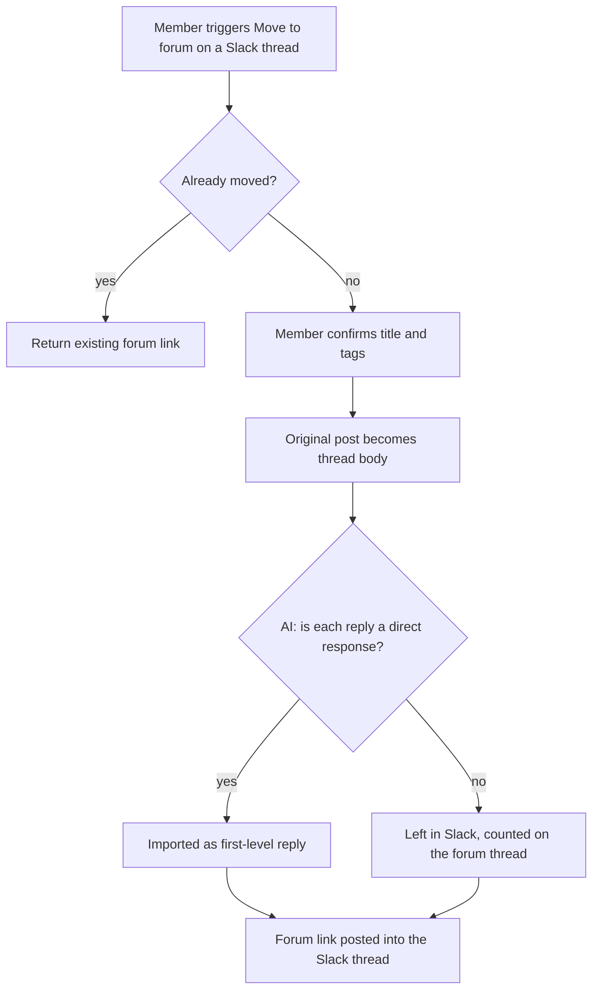
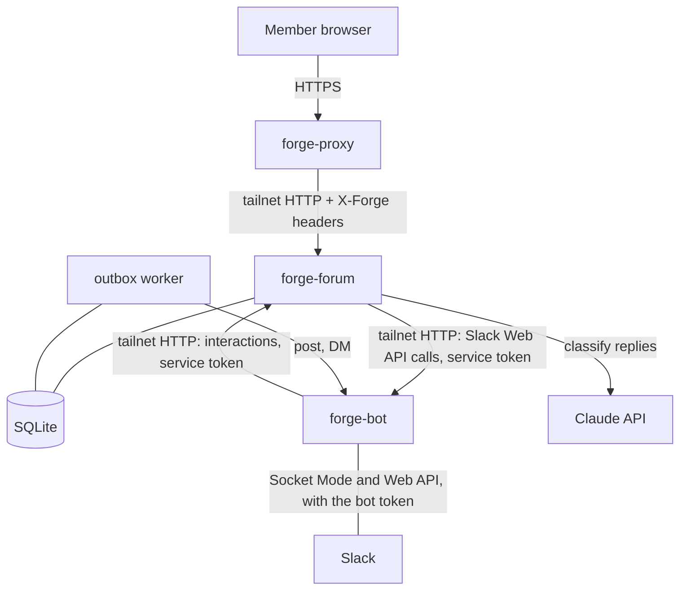
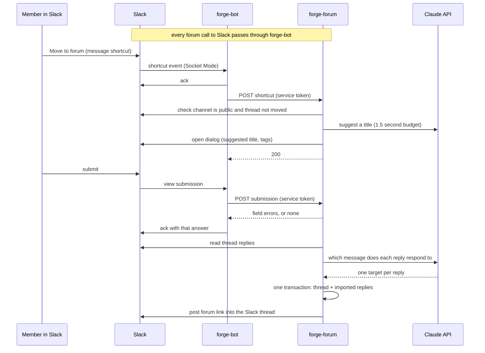

# Forge Forum - Plan

## Goal Capsule

- **Objective:** Give Forge Utah members a forum for long-running discussions, with nested replies ranked by upvotes, reachable from Slack and able to take over a Slack thread that has outgrown Slack.
- **Means:** One Go service with SQLite behind forge-proxy, talking to Slack through forge-bot, deployed to an exe.dev VM (KTD1, KTD5, KTD10).
- **Product authority:** This plan owns the forum and the first-level "Move to forum" action. Full reply-tree conversion of Slack threads and the forum-generated wiki are surrounding work, not active scope. On product behaviour the Requirements win; on mechanism the Key Technical Decisions win.
- **Stop conditions:** Stop and report if forge-proxy's upstream contract cannot be met as written, or if a requirement can only be met by exposing the forum to the public internet.
- **Execution profile:** Greenfield repository. Build in unit order; each unit lands with its tests passing.
- **Shipping:** The executor finishes at a verified local build plus the deploy artifacts. Steps that need Forge credentials are listed in the runbook (U8) for an operator.
- **Open blockers:** None.

---

## Product Contract

### Summary

Build a members-only forum for Forge Utah, behind forge-proxy (the Forge auth proxy), where threads live in one tagged feed and replies nest under what they answer, ranked by upvotes.
Slack stays the front door: new threads are announced there, members get a direct message when someone replies to them, and a "Move to forum" action turns a Slack thread into a forum thread made of the original post plus the replies AI identifies as direct responses to it.
The forum uses the Forge design system and is deployed to exe.dev.

### Problem Frame

Forge Utah's community lives in Slack, and Slack threads are flat.
A member asked who is building software factories.
Several people answered the question, then others answered those answers, and the thread passed 50 replies.
Responses to the original question and responses to each other are now interleaved in one chronological list, nothing marks the strongest answers, and a member arriving late cannot follow it.
The detail people contributed is effectively lost, and the next long discussion will go the same way.

### Key Decisions

- **Members only.** Everything sits behind forge-proxy, so nothing is public or linkable outside the Slack org. Governs R1, R2.
- **Build rather than adopt forum software.** The forum is a Forge community project, needs custom Slack behaviour, and must leave room for later features such as a wiki generated from forum content.
- **One feed with topic tags.** A small community's activity stays in one visible place instead of spreading across quiet sections. Governs R3, R4, R6.
- **Upvotes only.** Every member is a known Slack member, so downvotes would feel personal and add little. Governs R8, R9.
- **Slack is the front door.** Members are told about forum activity in Slack rather than expected to visit unprompted. Governs R11, R12, R13.
- **Moving a thread imports first-level replies only.** This rescues the direct answers now and leaves reply-tree reconstruction to the later conversion work. Governs R15, R16, R17.
- **Any member can move a thread, and authors do not opt in.** Imported posts carry their Slack authors' names; authors keep control afterwards. Governs R14, R19.
- **The move dialog pre-fills a short title suggested by AI from the original post.** The member can edit it. When the suggestion is not ready in time, the dialog pre-fills the start of the post. Governs R14.
- **The announcement channel is an operator setting.** Forge names the channel at deploy time. Governs R11.

<!-- ce-section: work-relationships -->
### How This Work Fits Together

This plan owns the forum and the first-level "Move to forum" action.
The breakdown below is the current understanding, not a committed roadmap.

- Full Slack thread conversion: use AI to rebuild the whole reply tree of a Slack thread, including replies to replies.
  - Depends on this plan's forum and its Slack identities on posts.
  - Shares the "Move to forum" entry point (R14) and extends R16 beyond first-level replies.
- Forum-generated wiki: produce wiki pages from forum content.
  - Depends on the forum holding enough discussion to draw from.
  - Still to decide: what triggers generation and who curates the result.

### Actors

- A1. Member: anyone in the Forge Utah Slack org. Reads, posts, replies, upvotes, and can move a Slack thread.
- A2. Forge admin: a member holding the `admin` role in forge-proxy, who also moderates content and curates tags.
- A3. Forum: the application, including its AI classification of Slack replies.
- A4. Slack: the Forge Utah workspace, as the source of identity, the place notifications land, and the source of moved threads.

### Requirements

**Access and identity**

- R1. Every forum page requires sign-in through forge-proxy; nothing is readable without membership in the Forge Utah Slack org.
- R2. A member's forum identity is the identity forge-proxy supplies (name, avatar, Slack user), with no separate sign-up or profile to create.

**Threads and feed**

- R3. Any member can start a thread with a title, a body, and one or more tags.
- R4. The front page is a single feed of all threads, ordered by most recent activity, which members can filter by tag or re-order by upvotes.
- R5. Thread and reply bodies support formatted text, including code blocks.
- R6. Tags come from a short list that Forge admins curate.

**Replies and voting**

- R7. A member can reply to a thread or to any reply, and each reply is shown nested under the post it answers.
- R8. A member can upvote any thread or reply once and can withdraw the upvote; there are no downvotes.
- R9. Replies that share a parent are ordered by upvote count, with ties going to the older reply.
- R10. Authors can edit and delete their own posts; an edited post is marked as edited, and a deleted reply that has replies under it leaves a placeholder so the tree stays intact.

**Slack notifications**

- R11. When a member starts a thread on the forum, the forum announces it in a designated Slack channel with its title, author, tags, and link.
- R12. When someone replies directly to a member's thread or reply, that member gets a Slack direct message linking to the reply; members are not notified of their own replies.
- R13. A member can turn off reply direct messages.

**Move to forum**

- R14. Any member can trigger "Move to forum" on a Slack thread in a public channel, confirming a title and tags before the forum thread is created.
- R15. The Slack thread's original post becomes the forum thread's body, credited to its Slack author.
- R16. AI classifies each Slack reply as a direct response to the original post or not; the direct responses become first-level forum replies, credited to their Slack authors and kept in their original order.
- R17. Slack replies not classified as direct responses are not imported; the forum thread links to the source Slack thread and says how many replies remain there.
- R18. After a move, the forum posts the new thread's link into the source Slack thread instead of making the R11 channel announcement.
- R19. Imported posts are marked as imported from Slack, belong to their Slack authors for the purposes of R10, and do not trigger R12 direct messages.
- R20. A Slack thread can be moved once; triggering the action again returns the existing forum thread's link.

**Moderation**

- R21. Forge admins can remove any thread or reply.

**Look and voice**

- R22. The forum follows the Forge design system's visual tokens and its copy rules in `../forge-design-system/README.md`.

### Key Flows

- F1. Start and grow a discussion
  - **Trigger:** A member has a question or topic that needs more than a Slack exchange.
  - **Actors:** A1, A3, A4
  - **Steps:** The member starts a thread with tags. Slack announces it. Others open the link, reply to the thread or to each other, and upvote. Each person replied to gets a direct message and returns.
  - **Outcome:** A discussion whose structure shows who answered what, with the best-supported replies at the top of each level.
  - **Covered by:** R3, R7, R8, R9, R11, R12

- F2. Move a Slack thread to the forum
  - **Trigger:** A Slack thread in a public channel has become hard to follow.
  - **Actors:** A1, A3, A4
  - **Steps:** A member triggers "Move to forum" and confirms a title and tags. The forum creates the thread from the original post, classifies the replies, and imports the direct responses as first-level replies. The forum posts the link back into the Slack thread. Members continue the discussion on the forum.
  - **Outcome:** The direct answers to the original question are readable in one place, credited to their authors, with a link back to Slack for the rest.
  - **Covered by:** R14, R15, R16, R17, R18, R19, R20



### Acceptance Examples

- AE1. **Covers R1.** Given someone who is not in the Forge Utah Slack org, when they open a forum thread link, then they see no forum content.
- AE2. **Covers R7, R9.** Given a thread with replies A (3 upvotes) and B (5 upvotes), and a reply C under A, when a member opens the thread, then B appears above A and C appears nested under A.
- AE3. **Covers R12, R13.** Given Dana replied to Sam's thread and Lee replied to Dana's reply, when Lee posts, then Dana gets a direct message and Sam does not; if Dana has turned direct messages off, nobody is messaged.
- AE4. **Covers R10.** Given a reply with two replies under it, when its author deletes it, then a placeholder stands in its position and the two replies remain nested under it.
- AE5. **Covers R15, R16, R17.** Given a 50-reply Slack thread in which 12 replies answer the original question and 38 answer other replies, when a member moves it, then the forum thread has the original post as its body, 12 first-level replies under their authors' names, and a link to Slack noting 38 replies remain there.
- AE6. **Covers R18, R19.** Given the move in AE5, when it completes, then the link appears in the source Slack thread, no channel announcement is made, and none of the 12 authors receives a direct message.
- AE7. **Covers R20.** Given a Slack thread that was already moved, when another member triggers "Move to forum" on it, then they are given the existing forum thread's link and no second thread is created.
- AE8. **Covers R14.** Given a thread in a private channel or a direct message, when a member looks for "Move to forum", then the move is refused.

### Success Criteria

- A member who was not in the "software factories" Slack thread can, after it is moved, tell which replies answer the original question and which were most supported.
- New long-form discussions start on the forum, or are moved there, rather than growing past readability in Slack.

### Scope Boundaries

**Deferred for later**

- Rebuilding the full reply tree of a moved Slack thread, including replies to replies.
- A wiki generated from forum content.
- Public or guest read access.
- Email notifications and in-forum notification feeds.
- Marking a reply as the accepted answer.

**Outside this product's identity**

- Downvotes and reputation scores.
- Member-created communities in the style of subreddits.
- Two-way mirroring between forum threads and Slack threads.

### Dependencies / Assumptions

- forge-proxy (https://github.com/forgeutah/forge-proxy) authenticates members through Slack sign-in for a single configured workspace and forwards identity to the apps behind it. The forum is an upstream app under its "Upstream-app contract", which the forum adopts as written: it keeps no login or sessions of its own.
- The forum must be reachable by forge-proxy the way existing upstream apps are, over the Forge tailnet and not from the public internet.
- The forum is deployed to exe.dev, the platform forge-proxy already runs on, and joins the Forge tailnet from there.
- An author of an imported post (R15, R16) may never have signed in to the forum, so the forum must be able to credit a Slack user it has not yet seen through forge-proxy and attach that member's posts to them when they first sign in.
- The Forge design system supplies tokens, type classes, a logo, and component specimens, with no packaged components. Thread lists, vote controls, nested replies, and the editor are new work in its style.
- The `admin` role in forge-proxy is the right group to moderate the forum; roles are assigned by forge-proxy operators.
- AI classification in R16 will sometimes be wrong. A direct response left in Slack remains reachable through the R17 link.
- The AI-suggested title in R14 will sometimes be poor or arrive too late. The member edits the title before the thread is created.

### Sources / Research

- https://github.com/forgeutah/forge-proxy (README, "Upstream-app contract"): the identity headers, shared-secret check, roles, and sign-out behaviour the forum relies on for R1 and R2.

- `../forge-design-system/README.md`: brand voice, audience, and copy rules that R22 binds.
- `../forge-design-system/colors_and_type.css`: design tokens and type classes; fonts load from Google Fonts.
- `../forge-design-system/preview/`: component specimens for buttons, inputs, cards, alerts, and badges.
- https://claude.ai/artifact/HeB5TntHxzgVi3LKFSyMPX: design canvas for the feed, thread, new-thread, and Slack touchpoint screens, built with the Forge Utah Design System.
- `../forge-website-hugo/config/_default/params.toml`: Slack is the site's only join action.

---

## Planning Contract

Product Contract preservation: changed: R14, R11 — the two questions deferred to planning are resolved as Key Decisions (an AI-suggested title pre-fill, announcement channel as a setting); no other scope change.

### Key Technical Decisions

- KTD1. **One Go binary, standard library HTTP, server-rendered HTML.** This mirrors forge-proxy's stack (Go, `net/http` mux, embedded assets, `log/slog`) so Forge volunteers maintain one style. Pages are `html/template` with plain form posts; there is no JavaScript build and no client framework, which also avoids the `unsafe-eval` CSP forge-proxy's in-browser JSX forces.
- KTD2. **SQLite through `modernc.org/sqlite`, with a writer pool of one and a read pool.** Same driver and pragmas as forge-proxy (WAL, `foreign_keys`, `busy_timeout`, `BEGIN IMMEDIATE` writes). Migrations are embedded SQL files applied at startup by a small in-repo runner; goose is not added because the forum needs only forward migrations.
- KTD3. **Members are keyed on Slack user ID, not `X-Forge-User-Id`.** forge-proxy creates a user row only at first sign-in and offers no lookup, so R15 and R16 authors who never signed in have no Forge user ID. The forum keeps its own member table keyed on Slack user ID and records the Forge user ID when that member first arrives. This departs from the proxy contract's advice to key on `X-Forge-User-Id`. Serves R2, R15, R16.
- KTD4. **Every request except the health check and forge-bot's interactions endpoint (KTD5) must pass the proxy contract.** The forum compares `X-Forge-Proxy-Secret` in constant time against a comma-separated list of accepted secrets, checks `X-Forge-Slack-Team-Id` against the configured workspace, and decodes `X-Forge-Name` per RFC 8187. Admin rights come from `X-Forge-Roles` containing the configured admin role. Serves R1, R21.
- KTD5. **The forum reaches Slack through forge-bot.** forge-proxy passes nothing without a session, so Slack cannot call a forum URL, and the workspace uses one Slack app for all Forge services. forge-bot, a separate service, therefore holds the Socket Mode connection and the bot token; the forum holds no Slack token. The bot posts the interactions the forum owns (the "Move to forum" shortcut and its dialog) to `POST /internal/slack/interactions`, an endpoint outside the proxy contract whose only gate is the forum's service token as a bearer token, compared in constant time. The forum calls Slack's Web API at the bot's `/slack/api/<method>` with the same token, using `github.com/slack-go/slack` behind an in-repo interface so tests use a fake. Both directions run over the Forge tailnet and follow forge-bot's service contract. With the bot's URL and token unset the forum runs with Slack features off and logs that once. Serves R11, R12, R14–R20.
- KTD6. **Notifications go through an outbox table.** The row is written in the same transaction as the post, and a background worker delivers it with bounded retries. A Slack outage therefore never fails a post or loses a notification silently. Serves R11, R12, R18.
- KTD7. **A move is one background job and one database transaction.** The shortcut handler only validates and opens the dialog. After submission the job reads the Slack thread, classifies replies, and writes the thread and its imported replies together; a unique key on Slack channel and thread timestamp makes a second move return the existing thread. If reading or classifying fails, nothing is imported and the mover is told in Slack. Serves R14–R20.
- KTD8. **Reply classification asks Claude which message each reply responds to.** Slack shows a thread as a flat list, so the forum sends the original post and the replies and asks, through the Anthropic Go SDK's JSON schema output, for the ID of the one message each reply responds to; the schema allows only the IDs that were sent. A reply is imported when that message is the original post, and every other reply stays in Slack (R17). The default model is Claude Sonnet 5.5 at medium effort, because it placed the replies of a real 73-reply thread correctly where asking for a yes or no on each reply did not. Every reply must get an answer: the forum asks once more when an answer leaves replies out, and if the second answer is also incomplete the move fails, nothing is imported, and the mover is told. Slack text is passed as delimited untrusted data, the model has no tools, and the forum rejects any ID it did not send. The classifier logs the model, the number of replies sent, the number judged direct, and whether it asked twice, never message text. The model ID is a setting.
- KTD9. **Replies are an adjacency list ordered in Go.** One query loads a thread's replies; the tree is built in memory and siblings sorted by score then age. Scores are a cached column updated in the same transaction as the vote row. Serves R7, R8, R9.
- KTD10. **Deployment is a static binary under systemd on an exe.dev VM.** Config comes from a root-owned env file, data lives under `/var/lib/forge-forum`, and the VM joins the Forge tailnet so forge-proxy and forge-bot can reach port 8080 and the forum can reach forge-bot. Litestream replication is documented as an optional sidecar, matching forge-proxy.
- KTD11. **Post bodies are stored as Markdown and rendered with goldmark, then sanitized.** Raw HTML is disabled and output passes through bluemonday. Imported Slack text is converted from mrkdwn by an in-repo converter because no maintained Go library does that direction. Serves R5, R15, R16.
- KTD12. **Deletion is soft.** A deleted reply with replies under it renders as the R10 placeholder; one with none disappears. A deleted or admin-removed thread leaves the feed and its URL shows a removed notice.
- KTD13. **The dialog's title comes from a fast model with a 1.5 second budget.** Slack allows three seconds from the member's click to open the dialog, and the rest of that path takes about one. Once the pre-dialog checks pass, the forum asks Claude Haiku 5.5 (the default; the model is a setting, `TITLE_MODEL`) for a title in one request with no tools, low effort, and no retry, and waits for it while it loads the tags and builds the fallback title. The request starts only after the checks so that the text of a post in a private channel is never sent. If no title arrives inside the budget, or the request fails, the dialog opens with the start of the post's first line, cut between words to 80 characters; the failure is logged and the member is not told. The post is passed as untrusted data inside a delimited block, and the suggestion only pre-fills a field the member can edit. Serves R14.

### High-Level Technical Design





### Output Structure

```text
cmd/forge-forum/main.go
internal/config/        env loading and validation
internal/db/            open, pools, migrations/*.sql, migration runner
internal/identity/      proxy-contract middleware, member upsert
internal/forum/         threads, replies, votes, tags, tree building
internal/markdown/      render + sanitize, Slack mrkdwn conversion
internal/slackx/        Slack interface, real client, fake, forge-bot interactions endpoint
internal/notify/        outbox writer and worker
internal/move/          move job, classifier interface, Claude classifier, title suggester
internal/web/           handlers, templates/*.html, assets/ (CSS, logo)
deploy/                 forge-forum.service, env example, runbook
```

### Assumptions

- The forum is served at `forum.<base domain>`; forge-proxy's docs use both `forgeutah.tech` and `forgeut.dev`, so the public base URL is a setting.
- Forge runs forge-bot with the workspace's Slack app, registers the forum in it, and supplies an Anthropic API key.
- Guests in the Slack workspace get the same access as members, as they do through forge-proxy.

### Risks

- Slack features depend on forge-bot being up. While it is down, posts still succeed, queued messages wait in the outbox and retry (KTD6), and "Move to forum" does not work.
- Whether a shortcut invoked on a reply carries the thread root timestamp is unverified in Slack's docs. U7 resolves the root by reading the thread from the invoked message.
- An interaction that arrives while the forum is down or restarting is not redelivered. forge-bot tells the member it did not work and they retry.

---

## Implementation Units

### U1. Service skeleton, configuration, and database

**Goal:** A binary that loads config, opens SQLite, applies migrations, and answers a health check.

**Requirements:** Foundation for all; KTD1, KTD2.

**Dependencies:** None.

**Files:** `go.mod`, `cmd/forge-forum/main.go`, `internal/config/config.go`, `internal/config/config_test.go`, `internal/db/db.go`, `internal/db/migrate.go`, `internal/db/migrations/0001_init.sql`, `internal/db/db_test.go`, `.gitignore`, `README.md`

**Approach:** Config is env-only and reports every problem at once. The first migration creates members, tags (seeded), threads, thread tags, replies, votes, notifications, and member settings. Graceful shutdown on signal.

**Patterns to follow:** forge-proxy's `internal/config` and `internal/db` (two pools, `WithWriteTx`, INTEGER unix timestamps).

**Test scenarios:**
- Config with all required values loads; a missing proxy secret and a short secret are both reported in one error.
- Slack and Anthropic settings absent yields a config with those features marked off, not an error.
- Opening a fresh database applies migrations; opening it again applies none.
- A write inside `WithWriteTx` that returns an error leaves no row.

**Verification:** The binary starts against an empty data directory and `/healthz` returns success.

### U2. Proxy contract and member identity

**Goal:** Only requests carrying the proxy contract reach forum pages, and each such request resolves to a member.

**Requirements:** R1, R2, R21; KTD3, KTD4. Covers AE1.

**Dependencies:** U1.

**Files:** `internal/identity/middleware.go`, `internal/identity/members.go`, `internal/identity/identity_test.go`

**Approach:** Middleware validates the secret, team, and contract version, decodes the name, upserts the member by Slack user ID, attaches the Forge user ID, and puts the member and admin flag in the request context. A changed name or avatar is stored at once; an unchanged member is rewritten at most once a minute, so ordinary requests do not take the writer.

**Test scenarios:**
- Covers AE1. A request with no secret, a wrong secret, or a wrong team ID gets 401 and no page content.
- A request with the previous secret from a two-secret list is accepted.
- First request from a Slack user creates a member; a second updates name and avatar without creating another.
- A member row created earlier by an import gains the Forge user ID on first sign-in and keeps its posts.
- `X-Forge-Name` in the RFC 8187 form decodes to the accented name.
- `X-Forge-Roles` containing the admin role sets the admin flag; an empty roles header does not.

**Verification:** Handlers behind the middleware can read the current member; nothing behind it is reachable without the secret.

### U3. Threads, feed, tags, and the Forge look

**Goal:** Members can start threads and browse the feed, in the approved design.

**Requirements:** R3, R4, R5, R6, R22; KTD1, KTD11.

**Dependencies:** U2.

**Files:** `internal/forum/threads.go`, `internal/forum/tags.go`, `internal/forum/threads_test.go`, `internal/markdown/render.go`, `internal/markdown/render_test.go`, `internal/web/server.go`, `internal/web/feed.go`, `internal/web/thread_new.go`, `internal/web/templates/layout.html`, `internal/web/templates/feed.html`, `internal/web/templates/thread_new.html`, `internal/web/assets/forum.css`, `internal/web/assets/tokens.css`, `internal/web/assets/forge-icon.svg`, `internal/web/web_test.go`

**Approach:** The feed lists live threads newest-activity first, with a tag filter and an upvote ordering, paginated. Templates and CSS follow the design canvas screens; `tokens.css` is copied from `../forge-design-system/colors_and_type.css`. Forms carry a CSRF token tied to the member.

**Test scenarios:**
- Creating a thread with a title, body, and two tags shows it at the top of the feed with both tags.
- Creating a thread with no tag, or an unknown tag, is rejected with a message and nothing is stored.
- A reply to an older thread moves it above a newer thread under recent-activity order; upvote order ranks by score.
- Filtering by a tag shows only threads carrying it.
- A body containing a script tag and a fenced code block renders the code and no script.
- A form post without a valid CSRF token is rejected.

**Verification:** The feed, new-thread page, and created thread match the canvas screens' structure and copy rules.

### U4. Replies, voting, editing, deleting, and moderation

**Goal:** Threads carry nested, ranked discussion that authors and admins can manage.

**Requirements:** R7, R8, R9, R10, R21, R6; KTD9, KTD12. Covers AE2, AE4.

**Dependencies:** U3.

**Files:** `internal/forum/replies.go`, `internal/forum/votes.go`, `internal/forum/tree.go`, `internal/forum/replies_test.go`, `internal/web/thread_view.go`, `internal/web/post_actions.go`, `internal/web/admin.go`, `internal/web/templates/thread.html`, `internal/web/templates/reply.html`, `internal/web/templates/edit.html`, `internal/web/templates/admin_tags.html`, `internal/web/thread_view_test.go`

**Approach:** The thread page renders the tree recursively. Vote, reply, edit, and delete are form posts that redirect back to the thread anchor. Admins see remove controls and a tag management page.

**Test scenarios:**
- Covers AE2. Replies A (3 upvotes) and B (5), with C under A: B renders above A and C nested under A.
- Two siblings with equal score render oldest first.
- A member upvoting twice leaves one vote; withdrawing returns the score to its prior value.
- Covers AE4. Deleting a reply that has two replies leaves a placeholder with both still nested; deleting a leaf reply removes it.
- A member editing another member's reply is refused; editing their own marks it edited.
- An admin removes another member's thread and it leaves the feed; a non-admin cannot.
- A reply to a reply in a different thread, or to a deleted thread, is refused.

**Verification:** The thread page matches the canvas thread screen, including the deleted-reply placeholder.

### U5. Slack client, announcements, and reply direct messages

**Goal:** Slack hears about new threads and members hear about replies to them.

**Requirements:** R11, R12, R13; KTD5, KTD6. Covers AE3.

**Dependencies:** U4.

**Files:** `internal/config/config.go`, `internal/slackx/client.go`, `internal/slackx/fake.go`, `internal/notify/outbox.go`, `internal/notify/worker.go`, `internal/notify/notify_test.go`, `internal/web/settings.go`, `internal/web/templates/settings.html`

**Approach:** The Slack client sends every Web API call to forge-bot with the forum's service token (KTD5). Thread creation enqueues an announcement; reply creation enqueues a direct message to the parent post's author unless that author is the replier or has turned messages off. The worker claims pending rows, sends, and marks them sent or retries with backoff up to a cap. Message wording follows the canvas Slack touchpoints board.

**Test scenarios:**
- Creating a thread on the forum enqueues one announcement carrying title, author, tags, and link; the fake client receives it.
- Covers AE3. Lee replies to Dana's reply in Sam's thread: Dana gets one message, Sam none; with Dana's messages off, none are enqueued.
- Replying to your own post enqueues nothing.
- The fake client failing twice then succeeding results in one delivered message; failing past the cap marks the row failed and stops.
- With Slack unconfigured, posting succeeds and outbox rows are marked skipped.

**Verification:** Posting never waits on Slack, and every enqueued row reaches a terminal state.

### U6. Slack text conversion and reply classification

**Goal:** Slack messages become clean Markdown, and replies are sorted into direct or not.

**Requirements:** R15, R16; KTD8, KTD11.

**Dependencies:** U1.

**Files:** `internal/markdown/slack.go`, `internal/markdown/slack_test.go`, `internal/move/classifier.go`, `internal/move/claude.go`, `internal/move/classifier_test.go`

**Approach:** The converter tokenizes code first, then rewrites mentions, channel links, URLs, emphasis, and the three escaped entities; mentions resolve through a lookup function. The classifier interface takes the original post and replies and returns the IDs of the replies that respond to the original post; the Claude implementation follows KTD8.

**Test scenarios:**
- A user mention becomes the member's display name; a labelled link becomes a Markdown link; bold and strike convert.
- Text inside inline code and fenced code is left untouched.
- Escaped angle brackets and ampersands are unescaped once.
- The Claude classifier, given a canned response naming an ID that was not sent, returns an error.
- A canned response naming a target that was not sent returns an error.
- A reply whose target is the original post is direct; one whose target is another reply, itself, or a later reply is not.
- A canned response omitting sent IDs is asked for once more; a complete second answer succeeds, and a second incomplete answer returns an error that says how many replies went unanswered.
- A reply whose text says to ignore instructions is passed as data and the request carries no tools.

**Verification:** Converter and classifier are usable by the move job with no Slack or network access in tests.

### U7. Move to forum

**Goal:** A member can move a public Slack thread to the forum from Slack.

**Requirements:** R14, R15, R16, R17, R18, R19, R20; KTD5, KTD7, KTD13. Covers AE5, AE6, AE7, AE8.

**Dependencies:** U5, U6.

**Files:** `internal/slackx/inbound.go`, `internal/slackx/inbound_test.go`, `cmd/forge-forum/build.go`, `internal/move/handler.go`, `internal/move/title.go`, `internal/move/title_test.go`, `internal/move/job.go`, `internal/move/move_test.go`, `internal/forum/import.go`

**Approach:** forge-bot acknowledges each interaction to Slack and posts it to the forum's interactions endpoint, which checks the bearer token and routes the shortcut and the dialog submission to the move handler. A shortcut answers 200 once the dialog is open, or 500 so the bot tells the member; a submission answers with its field errors, or none, well inside the 2.5 seconds the bot waits. The handler resolves the thread root from the invoked message, refuses non-public channels, and answers an already-moved thread with its link. It then opens the dialog with a title suggested from the original post, or with the start of that post when the suggestion fails or is late (KTD13). The job follows KTD7, creates member rows for unseen Slack authors from Slack profile data, marks imported posts, records the count left in Slack, and enqueues the link-back in place of the announcement.

**Test scenarios:**
- Covers AE5. A 50-reply thread where the fake classifier marks 12 direct yields a forum thread with the original post as body, 12 first-level replies in original order under their authors, and "38 remain" recorded.
- Covers AE6. After that move, the outbox holds one link-back to the Slack thread, no channel announcement, and no direct messages.
- Covers AE7. Moving the same Slack thread again returns the existing forum link and creates nothing.
- Covers AE8. A shortcut invoked in a private channel or direct message is refused before any dialog opens.
- An imported author who has never signed in is credited by Slack name; when they later sign in they can edit that post.
- The shortcut invoked on a reply moves the whole thread from its root, and the title is suggested from the root post.
- With a fake suggester, the dialog opens with the suggested title.
- A suggester that fails, answers blank, or is not configured leaves the dialog pre-filled with the start of the post's first line, at most 80 characters and cut between words.
- A suggester slower than the budget does not hold the dialog: it opens with the fallback once the budget is spent.
- A refused move (private channel, already moved, original post without text or started by an app) never calls the suggester.
- The Claude suggester returns one clean line from a canned answer: quotes, extra lines, and a trailing period are removed, and an over-long answer is cut between words. An empty answer, an API error, and a stalled server each return an error, after exactly one request.
- The suggester's request carries the post inside its data block, low effort, and no tools.
- The classifier failing leaves no thread and tells the mover it failed.
- A submission with no tag selected returns a dialog validation error.
- An interaction without the service token is refused with 401 and reaches no handler; with "Move to forum" off the endpoint answers 404.

**Verification:** With fakes for Slack and the classifier, the whole move runs end to end in a test.

### U8. Deployment to exe.dev

**Goal:** The forum runs on an exe.dev VM and an operator knows the remaining steps.

**Requirements:** KTD10; Goal Capsule shipping line.

**Dependencies:** U1–U7.

**Files:** `deploy/forge-forum.service`, `deploy/forge-forum.env.example`, `deploy/RUNBOOK.md`, `deploy/litestream.yml`, `Makefile`

**Approach:** Build a static Linux binary, install it with the systemd unit and env file, and start it. The runbook lists what needs Forge credentials: the shared proxy secret, the forum's forge-bot registration and service token, the Anthropic key, joining the tailnet, adding the host to forge-proxy's `UPSTREAMS`, and DNS.

**Execution note:** This is packaging and operations; prove it with a runtime smoke check on the VM, not unit tests.

**Test scenarios:** Test expectation: none -- deployment packaging; verified by the smoke check below.

**Verification:** On the VM the service is active, `/healthz` succeeds, a request without the proxy secret is refused, and a request with the configured secret and identity headers returns the feed.

---

## Verification Contract

| Check | Command | Applies to |
|---|---|---|
| Build | `go build ./...` | every unit |
| Static checks | `go vet ./...` | every unit |
| Tests | `go test ./...` | U1–U7 |
| Smoke | service active and `/healthz`, refusal without secret, feed with secret, on the VM | U8 |

Slack and Claude are faked in tests. Their live behaviour is checked by the runbook's post-deploy checklist once credentials exist.

---

## Definition of Done

- Every requirement R1–R22 is met by a unit, and every acceptance example AE1–AE8 has a passing test.
- All commands in the Verification Contract pass.
- The pages follow the design canvas and the copy rules in `../forge-design-system/README.md`.
- `deploy/RUNBOOK.md` lists each operator step with the setting it fills.
- No abandoned or experimental code remains in the tree.
